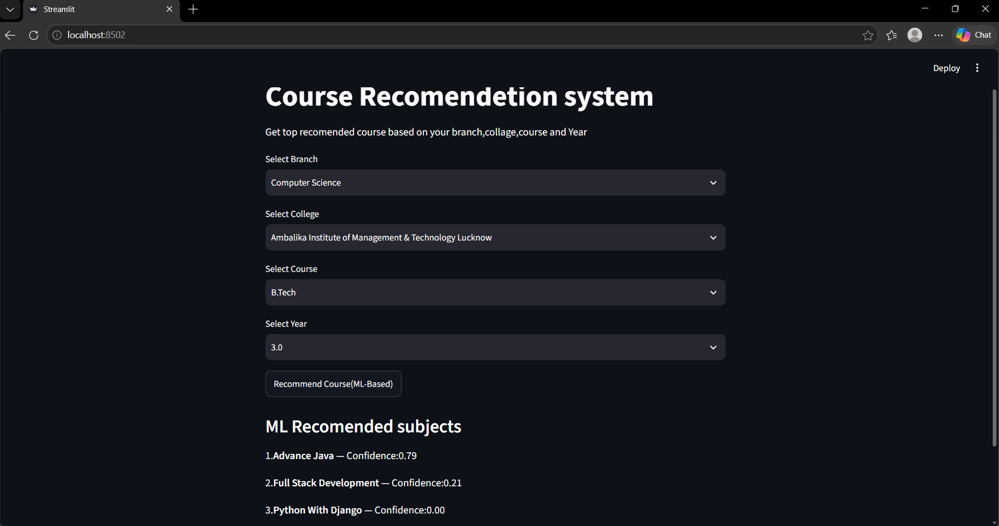

# Course Recommendation System

A Machine Learning-based Course Recommendation System built using Python and Streamlit. It recommends relevant subjects based on the student's branch, college, course, and academic year.
## Live Demo

[Open Course Recommendation System](https://course-recommendation-system-ansh.streamlit.app/)

## Project Overview

This project uses a Random Forest Classifier to predict and recommend the top 3 relevant subjects based on student information.

## Features

- Select student branch
- Select college
- Select course
- Select academic year
- Machine Learning-based subject recommendations
- Top 3 recommended subjects with confidence scores

## Technologies Used

- Python
- Streamlit
- Pandas
- NumPy
- Matplotlib
- Seaborn
- Scikit-learn
- Random Forest Classifier
- Excel Dataset

## Project Structure

```text
course-recommendation-system/
│
├── main.py
├── MIS Data.xlsx
├── requirements.txt
├── README.md
├── LICENSE
└── .gitignore
```
## Project Screenshot


